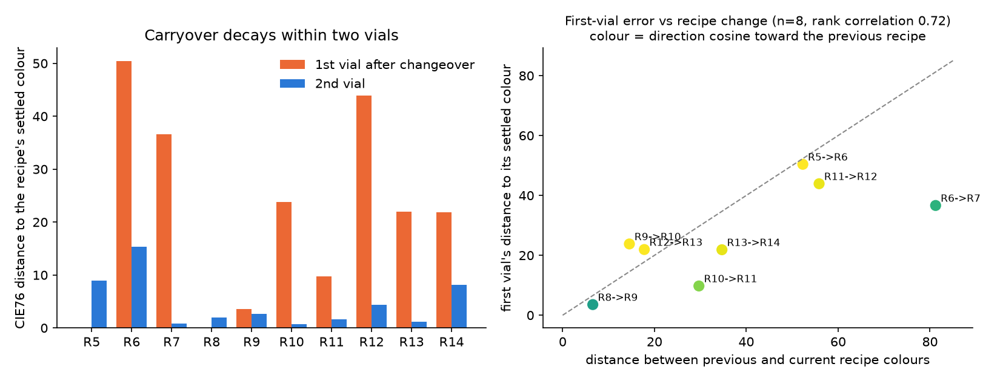

# End-to-end carryover flag on video 5 (measured)

This page records the first end-to-end run of the decision stage on a real recording: for each of
the 30 vials in video 5, the pipeline measured the vial's final-mixture colour from the fill camera,
compared it with the settled colour of the same recipe, applied a fixed rule, wrote a deterministic
operator message, and linked the vial to the camera ID the top-down tracker assigned it in the
cap/seal lane. Everything below was computed by the scripts named under "How to run" from the
three video-5 recordings and the label CSVs in `data/`. Where a number is **measured** it came from a
script; where something is **assumed** it is called that.

Status: an **in-sample demonstration of a fixed rule, not a validation.** Video 5 has no defect labels
([evaluation](evaluation.md)), every vial comes from one recording, and the rule's threshold floor
coincides with an older video-5 statistic (see "Provenance of the rule" below). No real-video data
was used to train or tune anything; the rule is hand-written and nothing in it is learned.

## Inputs

- The three video-5 recordings, `cap_seal`, `vial_fill` and `tank_level`, each 50942 frames at 30 fps
  (checked with cv2). The demo treats them as frame-synchronized: the same frame index is the same
  instant, so one frame number addresses all three cameras. That is how the three-panel clips are cut.
- The recipe schedule (`data/video5_vial_recipes.csv`: recipe id, tank volumes, fill start and end frame
  per vial) and the derived transitions (`data/video5_transitions.csv`: previous recipe, whether it
  changed, position in the run). These are hand labels standing in for the PLC's programmed recipe, the
  control-system signal the pipeline would read on a line. They are **not** model outputs.
- The final-mixture windows (`data/real_check_windows.csv`: per vial, the frames after the fill in which
  the liquid has settled and the cart has not yet moved, with an eligible flag and exclusion reason).
- `data/video5_vial_colors.csv`, an older three-frame colour measurement, used only for comparison.

## What is measured, and the fixed rule

**Colour (measured).** For every frame of a vial's final-mixture window, the median RGB of the top
0.7 % most saturated pixels in a fixed crop of the fill station (rows 150:430, columns 180:420 of the
`vial_fill` frame), converted to CIE Lab (D65). The vial's colour is the per-channel median over those
frames; its measurement noise is the median CIE76 distance between consecutive frames. The crop and the
saturation rule were chosen by eye earlier in the project on this same video (an assumption, not fitted
to any outcome).

**Reference (leave-one-out, per recipe).** For a vial of recipe R, the per-channel median Lab of the
*other* vials of recipe R whose position in the run is 2 or later. A vial never contributes to its own
reference. No such peer: `insufficient_evidence`.

**Rule, stated exactly as implemented in `src/fluidmix/carryover/decide.py`:**

    tau = max(2.3, 3 x median within-window measurement noise over the eligible vials)
    decision = discard if CIE76(measured, reference) > tau, else keep

On this run the median noise was 0.000, so the floor decided every vial: **tau = 2.30**.

**Baseline: a stand-in for the line's known-colour check** (pass if the colour is within tau of *any*
recipe's reference colour; the real Teledyne outputs are not in the dataset). The vial's own recipe uses
the same leave-one-out reference. Such a check recognises a known colour but cannot tell a
wrong-but-known colour from the right one. Every "known-colour check" column below is this stand-in,
not a measurement of the plant's system.

**Explanation.** A deterministic template (`src/fluidmix/carryover/explain.py`) built only from the
record's fields: vial, recipe, previous recipe, dE, tau and decision. The operator message is a
deterministic template; an optional Cosmos Reason client exists in
`src/fluidmix/carryover/explain_cosmos.py` but is not called by the pipeline and has not been run.

## Results

Verbatim from `outputs/carryover-video5/results.md`:

> tau = max(2.3, 3 * median noise) = **2.30** (median frame-to-frame noise over eligible vials = 0.000).

### Agreement with the process assumption (not scoring)

Video 5 has no defect labels. The grouping rests on an **assumption** from the dispensing-order argument:
position 1 after a recipe change is assumed to carry residue of the previous recipe, and positions 2
and 3+ (same recipe again) are assumed clean. Because the reference colour of every vial is built from
the vials assumed clean, a position-1 vial is flagged whenever it differs from its successors for any
reason. The position-1 row therefore shows agreement with the assumption, not detection accuracy, and
the position-2 and 3+ rows are the matching false-alarm rate under the same assumption.

| group | discard (fixed rule) / total | known-colour check fail / total |
|---|---|---|
| position 1 after a recipe change | 8 / 8 | 7 / 8 |
| position 2 | 5 / 10 | 5 / 10 |
| position 3 or later | 5 / 10 | 5 / 10 |

Not decided (insufficient_evidence): vial 1 (previous_recipe_unknown); vial 10 (window_too_short).

The one position-1 vial the known-colour check passes is vial 22 (recipe 12 after recipe 11, dE 41.7
against its own recipe): its colour is close to a different known recipe, which is exactly the case a
known-colour check cannot catch and a per-recipe comparison can.

### Per-vial table

| vial | recipe | prev | pos | measured Lab | noise dE | reference Lab | dE vs ref | tau | decision | known-colour check |
|---|---|---|---|---|---|---|---|---|---|---|
| 1 | 5 | unknown | 1 | null | null | null | null | 2.30 | insufficient_evidence | null |
| 2 | 5 | 5 | 2 | [14.0, -16.5, 12.6] | 0.00 | [15.6, -9.4, 17.9] | 9.0 | 2.30 | discard | fail |
| 3 | 5 | 5 | 3 | [15.6, -9.4, 17.9] | 0.25 | [14.0, -16.5, 12.6] | 9.0 | 2.30 | discard | fail |
| 4 | 6 | 5 | 1 | [16.3, -8.0, 18.9] | 0.00 | [32.9, 23.9, 42.2] | 42.8 | 2.30 | discard | fail |
| 5 | 6 | 6 | 2 | [29.2, 18.6, 38.1] | 0.00 | [36.7, 29.1, 46.3] | 15.3 | 2.30 | discard | fail |
| 6 | 6 | 6 | 3 | [36.7, 29.1, 46.3] | 0.60 | [29.2, 18.6, 38.1] | 15.3 | 2.30 | discard | fail |
| 7 | 7 | 6 | 1 | [15.1, -15.1, 5.2] | 0.88 | [34.2, -9.1, -25.2] | 36.5 | 2.30 | discard | fail |
| 8 | 7 | 7 | 2 | [34.3, -9.4, -24.9] | 0.00 | [34.1, -8.8, -25.5] | 0.8 | 2.30 | keep | pass |
| 9 | 7 | 7 | 3 | [34.1, -8.8, -25.5] | 0.00 | [34.3, -9.4, -24.9] | 0.8 | 2.30 | keep | pass |
| 10 | 8 | 7 | 1 | null | null | null | null | 2.30 | insufficient_evidence | null |
| 11 | 8 | 8 | 2 | [16.9, -12.9, 16.4] | 0.00 | [15.1, -12.1, 15.9] | 2.0 | 2.30 | keep | pass |
| 12 | 8 | 8 | 3 | [15.1, -12.1, 15.9] | 0.00 | [16.9, -12.9, 16.4] | 2.0 | 2.30 | keep | pass |
| 13 | 9 | 8 | 1 | [13.3, -7.0, 15.3] | 0.00 | [11.1, -7.0, 11.4] | 4.5 | 2.30 | discard | fail |
| 14 | 9 | 9 | 2 | [10.8, -6.2, 10.5] | 0.00 | [11.5, -7.8, 12.4] | 2.6 | 2.30 | discard | fail |
| 15 | 9 | 9 | 3 | [11.5, -7.8, 12.4] | 0.00 | [10.8, -6.2, 10.5] | 2.6 | 2.30 | discard | fail |
| 16 | 10 | 9 | 1 | [7.0, -8.3, 4.0] | 0.00 | [21.1, -8.4, 22.9] | 23.6 | 2.30 | discard | fail |
| 17 | 10 | 10 | 2 | [21.0, -8.1, 22.7] | 0.00 | [21.3, -8.7, 23.1] | 0.7 | 2.30 | keep | pass |
| 18 | 10 | 10 | 3 | [21.3, -8.7, 23.1] | 0.00 | [21.0, -8.1, 22.7] | 0.7 | 2.30 | keep | pass |
| 19 | 11 | 10 | 1 | [18.8, -16.8, 2.3] | 0.00 | [16.7, -12.5, -6.3] | 9.8 | 2.30 | discard | fail |
| 20 | 11 | 11 | 2 | [17.4, -12.7, -6.7] | 0.00 | [16.1, -12.3, -5.9] | 1.6 | 2.30 | keep | pass |
| 21 | 11 | 11 | 3 | [16.1, -12.3, -5.9] | 0.00 | [17.4, -12.7, -6.7] | 1.6 | 2.30 | keep | pass |
| 22 | 12 | 11 | 1 | [10.9, -8.3, 10.1] | 0.00 | [21.8, 25.7, 31.8] | 41.7 | 2.30 | discard | pass |
| 23 | 12 | 12 | 2 | [21.1, 23.8, 30.9] | 0.00 | [22.4, 27.6, 32.7] | 4.4 | 2.30 | discard | fail |
| 24 | 12 | 12 | 3 | [22.4, 27.6, 32.7] | 0.00 | [21.1, 23.8, 30.9] | 4.4 | 2.30 | discard | fail |
| 25 | 13 | 12 | 1 | [25.1, 29.2, 36.1] | 0.00 | [16.0, 13.9, 22.5] | 22.4 | 2.30 | discard | fail |
| 26 | 13 | 13 | 2 | [15.9, 13.7, 22.0] | 0.00 | [16.0, 14.1, 23.0] | 1.1 | 2.30 | keep | pass |
| 27 | 13 | 13 | 3 | [16.0, 14.1, 23.0] | 0.00 | [15.9, 13.7, 22.0] | 1.1 | 2.30 | keep | pass |
| 28 | 14 | 13 | 1 | [14.1, 0.2, 18.3] | 0.00 | [15.7, -11.2, 3.5] | 18.8 | 2.30 | discard | fail |
| 29 | 14 | 14 | 2 | [12.6, -9.4, 5.4] | 0.00 | [18.9, -13.0, 1.6] | 8.2 | 2.30 | discard | fail |
| 30 | 14 | 14 | 3 | [18.9, -13.0, 1.6] | 0.44 | [12.6, -9.4, 5.4] | 8.2 | 2.30 | discard | fail |

### Sensitivity (diagnostic only, not used for selection; tau stays fixed)

Discards among decided vials at tau x 0.5 / x 1 / x 2: 22 / 18 / 13 of 28 (tau = 1.15 / 2.30 / 4.60).

### Sanity check against the older rough measurement

The older method (`data/video5_vial_colors.csv`) sampled three single frames at 15, 30 and 45 frames
after the fill end; this run uses every frame of the measured final-mixture window. Same crop and pixel
rule. Median CIE76 between the two methods: 1.0; max 16.6 (vial 6). Gaps above 2.0: vial 3 (3.6), vial 6
(16.6), vial 16 (3.3), vial 19 (2.6). For vials 3 and 6 the cart started moving at or before the old
method's last sample (19 and 21 frames after the fill end), so a moving cart is a plausible cause of the
gap (a hypothesis, not shown). For vials 16 and 19 the cart moved well after the last sample (77 and 71
frames), so those gaps are unexplained. The cart also moved early for vials 2, 4, 5 and 7, whose gaps are
small (0.6, 1.1, 1.1, 0.6), so cart movement alone does not account for the gap sizes.

### Flaws in the fixed rule seen after the run (reported, not corrected)

- The noise estimator collapsed. The per-frame colour is the median of integer pixels, so most
  consecutive-frame steps are exactly 0 (zero-step fraction per vial, median over eligible vials = 0.72;
  within-window peak-to-peak L range, median over vials = 1.07). tau therefore fell to the floor 2.3,
  which measures frame-to-frame quantisation, not how much two settled vials of the same recipe differ.
- With three vials per recipe, the leave-one-out reference of a position-2 vial is just the position-3
  vial and vice versa, so each pair gets the same dE and is flagged or kept together. Settled
  same-recipe pairs differ by 9.0, 15.3, 0.8, 2.0, 2.6, 0.7, 1.6, 4.4, 1.1, 8.2 dE (positions 2 vs 3), so a
  threshold near 2.3 flags half of them; the position-1 vials differ by 42.8, 36.5, 4.5, 23.6, 9.8, 41.7,
  22.4, 18.8.
- Proposal (not applied): base tau on the between-vial spread of settled same-recipe vials from a
  separate calibration recording, not on frame-to-frame noise, and fix it before scoring.

## Attribution: does the error point at the previous recipe? (descriptive, no thresholds)

`scripts/carryover_attribution.py` fits each early vial's measured colour as a mix of its own recipe's
settled colour and the previous recipe's settled colour, and reports the fitted share of the previous
recipe, the residual the mix does not explain, and the cosine between the deviation and the direction
toward the previous recipe (1.0 = points straight at it). Each recipe's settled colour in this analysis
is its single position-3 vial (n=1 per recipe), not a median of two; the decision rule above uses a
different reference, the leave-one-out median of position>=2 peers (so for a position-2 vial it is the
position-3 vial alone). Full table: [attribution.md](assets/carryover/attribution.md); figure:
[attribution.png](assets/carryover/attribution.png) (both copied from the script's output
`outputs/carryover-video5/`).



| vial position in a run | distance to the recipe's settled colour, median [range] | direction cosine toward the previous recipe, median | fitted share of the previous recipe, median [range] |
|---|---|---|---|
| first vial after a recipe change (n=8) | 22.9 [3.5 to 50.4] | 0.97 (5 of 8 at or above 0.9) | 0.68 [0.27 to 1.63] |
| second vial (n=10) | 2.3 [0.7 to 15.3] | the three that still deviate (vials 5, 23, 29: dE 15.3, 4.4, 8.2) have cosine 0.99, 0.94, 0.69 toward the pre-run recipe; the small deviations point in no particular direction | 0.29, 0.07, 0.16 for those three |

Reading: the colour error of the first vial after a changeover is explained by the previous recipe and
decays within two vials. Larger recipe changes gave larger first-vial errors in 6 of 8 changeovers
(rank correlation 0.72, n=8; vials 16 and 25 exceed their recipe gap). The 0.72 is Spearman's rho on
the table's one-decimal values as the script now reports it (0.69 on the unrounded values; vials 25 and
28 tie at 21.9 only after rounding); it is a reading of eight points, not a fitted law. The exception
is recipe 9 after recipe 8 (vial 13), whose two recipes are only 6.6 units apart, so carryover cannot
be seen in colour there. A share above 1 means the vial looks even more like the previous recipe than
that recipe's own settled vial; with one settled vial per recipe and uncalibrated camera colour, shares
are indicative, not volumetric. This section involves no threshold and no decision; it is the
measurement the fixed rule above is trying to turn into one.

## Limits

The recipe schedule and fill times come from hand labels, not from a live PLC signal, and every vial is
from one recording (video 5) with one camera, so this is an in-sample check of the rule, not a validation
on held-out data. The rule and tau formula were not changed after the first run, but they were not frozen
independently of video 5 (next section), and the measurement region (crop and top-0.7 % saturation rule)
was chosen by eye earlier in the project on this same video. References are leave-one-out medians of at
most two peers per recipe (for a position-2 vial, the position-3 vial alone), so a single odd peer moves
the reference; the known-colour check uses the same tau and references and is only a stand-in baseline.
CIE76 on camera sRGB is not a calibrated colour difference.

## Provenance of the rule and tau

- tau = max(2.3, 3 * median noise) is stated by its author to have been written in `decide.py` before
  `scripts/carryover_video5.py` was first run, and it has not been changed since. No auditable pre-run
  record of the rule exists: it was not committed or recorded in a dated freeze note before the run, so
  the ordering rests on the author's statement alone and cannot be checked from the repository
  ([feasibility protocol](feasibility-protocol.md) asks for a timestamped freeze). Earlier wording that
  the rule was "frozen before any measurement was seen" and that "nothing was tuned on video 5" has been
  withdrawn.
- The noise term is computed in-sample: 3 * median(measurement_noise_dE) over the 28 scored vials =
  0.000, so the floor alone decided every vial (tau = 2.30).
- The floor 2.3 and multiplier 3 were chosen by hand. 2.3 is the value commonly quoted as the CIE76
  just-noticeable difference, but it is also exactly the median position-2 dE of these same vials under
  the older method: position-2 values 0.0, 0.9, 1.6, 1.7, 1.7, 2.9, 4.5, 5.1, 8.8, 9.3, median 2.3;
  position-1-after-change values 3.5, 8.7, 15.8, 22.1, 22.3, 24.9, 34.9, 37.9, 44.2, median 22.3. With no
  freeze record predating that file, the floor cannot be claimed independent of video 5. This run is
  therefore an in-sample demonstration whose threshold coincides with a prior video-5 statistic. The rule
  was deliberately left unchanged rather than re-tuned on the outcome; any future tau must be set on twin
  val per [evaluation](evaluation.md) and frozen in a dated, committed note.

## Linking decisions to the top-down camera ID

The frozen dense53 segmenter and tracker ([cap segmenter](topdown-cap-segmenter.md)) were run on
`cap_seal_video_5.mp4` with the real-evaluation protocol and confidence floor 0.90, using the checkpoint
whose sha256 matches `models/topdown/dense53-frozen-model.json`. Measured: 50942 frames in 720.4 s
(70.7 fps on the DGX Spark GB10 over video 5), 47 distinct track IDs (CV001 to CV047), 124874 raw
boxes, and no tracker exit events (`tracker_exit_events` is empty in `summary.json`). That last number
is expected, not a fault: the guarded tracker's own exit line sits at y = 22, above where tracks end, so
it never fires on the real videos, and the frozen harness scores crossings of the reference line at
y = 100 from track positions instead. The run script records those reference-line crossings per track
(`line_crossings` in `summary.json`); the stored run on the Spark has 18 of them. Checked on 2026-11-01
against the draft trajectory labels: each of the 18 lies within one frame of a distinct one of the 27
labelled crossing intervals (for example track CV007 at frame 5416 against the labelled crossing of
cap5-T002 at frames 5415 to 5416), the same 18 of 27 the committed harness report counts
(`data/topdown/harness-report-dense53.json`, video 5: expected_reference_exits 27, missed 9). The frozen
scorer and the draft trajectory labels are not in git; they live on the team's DGX Spark at
`/home/hackathon5/outputs/topdown-01a17f15-20261029/dense-real53/` (source/heldout_tracking.py sha256
8ddf32c0..., source/evaluate_topdown_segmentation.py sha256 a2eb4e16..., trajectories.json sha256
9fdda3cb...), and the committed harness reports in `data/topdown/` are their output. The crossing check
above is not a stored artifact; it was re-run by hand against that trajectories.json.

`scripts/carryover_demo.py` then links each vial's decision to a camera ID by a stated rule: the first
unassigned lane-entry event (a track born at centre y > 436, the bottom of the lane) in the window
[fill end + 30 frames, fill end + 90 s], assigned greedily in vial order. Two documented adjustments to
the raw track list: one- or two-frame tracks with no follow-on birth within 60 frames are treated as
detector flicker, and a track born within 60 frames after an entry track ended near the lane bottom is
treated as the same vial re-identified (the tracker often fragments an entry into a short ID at y~476 and
a long ID at y~446). After those adjustments there are **27 lane-entry events for 30 vials: 27 of 30
vials linked to a camera ID** (unverified: no label checks the links, and a missed lane entry can shift
the greedy assignment by one vial; unlinked: vials 4, 29, 30). The delay between fill end and lane birth
(7.0 s to 87.3 s) is reported per vial so a reader can judge. The crossing column is the first
reference-line crossing (y = 100) recorded by the run script for any of the vial's fragment IDs:
**18 of the linked vials have a recorded reference-line crossing**, the same 18 of 27 the harness report
counts.

| vial | recipe | decision | camera ID [fragments] | birth frame | delay s | reference-line crossing frame |
|---|---|---|---|---|---|---|
| 1 | 5 | insufficient_evidence | CV003 [CV002+CV003] | 3102 | 76.5 | - |
| 2 | 5 | discard | CV007 [CV006+CV007] | 4652 | 81.4 | 5416 |
| 3 | 5 | discard | CV009 [CV008+CV009] | 6235 | 87.3 | - |
| 4 | 6 | discard | - | - | - | - |
| 5 | 6 | discard | CV010 | 8424 | 77.7 | 9184 |
| 6 | 6 | discard | CV012 [CV011+CV012] | 9092 | 56.7 | 10106 |
| 7 | 7 | discard | CV013 | 10250 | 33.6 | - |
| 8 | 7 | keep | CV014 | 12809 | 66.0 | - |
| 9 | 7 | keep | CV017 [CV016+CV017] | 13198 | 25.7 | 14143 |
| 10 | 8 | insufficient_evidence | CV018 | 15073 | 29.7 | 15837 |
| 11 | 8 | keep | CV020 [CV019+CV020] | 17744 | 63.2 | - |
| 12 | 8 | keep | CV021 | 18410 | 27.1 | 19425 |
| 13 | 9 | discard | CV022 | 20150 | 15.3 | 20898 |
| 14 | 9 | discard | CV024 | 22809 | 34.3 | 23975 |
| 15 | 9 | discard | CV025 | 24135 | 7.0 | 25115 |
| 16 | 10 | discard | CV028 [CV027+CV028] | 26269 | 19.6 | - |
| 17 | 10 | keep | CV029 | 28316 | 30.3 | 29766 |
| 18 | 10 | keep | CV031 [CV030+CV031] | 30361 | 42.1 | 31121 |
| 19 | 11 | discard | CV032 | 31717 | 26.3 | 32482 |
| 20 | 11 | keep | CV033 | 34330 | 52.1 | 35094 |
| 21 | 11 | keep | CV035 [CV034+CV035] | 35289 | 23.0 | 36238 |
| 22 | 12 | discard | CV037 [CV036+CV037] | 37396 | 25.9 | - |
| 23 | 12 | discard | CV038 | 39369 | 22.4 | 40137 |
| 24 | 12 | discard | CV040 [CV039+CV040] | 42268 | 49.1 | 43030 |
| 25 | 13 | discard | CV042 | 43165 | 15.2 | 44169 |
| 26 | 13 | keep | CV044 [CV043+CV044] | 45439 | 27.3 | 46811 |
| 27 | 13 | keep | CV046 [CV045+CV046] | 47264 | 23.9 | - |
| 28 | 14 | discard | CV047 | 50585 | 85.0 | - |
| 29 | 14 | discard | - | - | - | - |
| 30 | 14 | discard | - | - | - | - |

## Demo clips

Lane-pass clips (`scripts/carryover_lane_clip.py VIAL ...`): the inspection lane at 3x following one vial's camera ID
from its birth at the lane bottom to its reference-line crossing, with the decision card beside it; the frame
border flashes for 45 frames from the recorded crossing. Rendered for vial 25 (first after recipe 12, discard),
vial 13 (first after recipe 8, discard) and vial 17 (repeat, keep) into
`outputs/carryover-video5/demo/lanepass_vialNN_<decision>.mp4` with a JPEG at the crossing frame. These are the
only clips that show a crossing; like the three-camera clips they live on the Spark, not in git.

### Three-camera changeover clips

Five three-panel clips (tank_level | vial_fill | cap_seal, 1936 x 550, 30 fps, written with cv2, mp4v) live
on the DGX Spark at `/home/hackathon5/liamreporoot/topdown-results-20261101/outputs/carryover-video5/demo/`
and are **not in git** (20 to 34 MB each). Each runs from 150 frames before the fill end to 600 frames
after it, extended when needed so the linked camera ID's birth is on screen. The middle panel shows the
PLC recipe, the measurement crop, the measured and reference colour swatches, the dE, tau and
known-colour result, the operator message, and a decision card that reads PENDING until the measurement
window has closed. The right panel shows the tracker boxes and the linked ID. Every number drawn comes
from `records.json` or `links.json`. None of the five clips contains a reference-line crossing: each ends
at fill end + 600 frames or the linked ID's birth + 150 frames, and on video 5 the crossing comes 748 to
1450 frames after the lane birth (vials 7, 16 and 22 have no recorded crossing at all), so the
crossing flash that `carryover_demo.py` can draw never appears in them.

| clip | vial | length | what it shows |
|---|---|---|---|
| `changeover_vial07_recipe6to7_discard.mp4` | 7 | 43.7 s | first vial after recipe 6 to 7, dE 36.5, discard; known-colour check fail |
| `changeover_vial13_recipe8to9_discard.mp4` | 13 | 25.3 s | first vial after recipe 8 to 9, dE 4.5, the smallest flagged changeover |
| `changeover_vial16_recipe9to10_discard.mp4` | 16 | 29.7 s | first vial after recipe 9 to 10, dE 23.6, discard |
| `changeover_vial22_recipe11to12_discard.mp4` | 22 | 36.0 s | first vial after recipe 11 to 12, dE 41.7, discard, but the known-colour check **passes** |
| `keep_vial17_recipe10_keep.mp4` | 17 | 40.3 s | repeat 2 of recipe 10, dE 0.7, keep |

A still (`.jpg`) of each clip sits beside it.

## How to run

From the repository root, in a virtual environment with `pip install -r requirements-dev.txt` (it lists
opencv-python, matplotlib and torch; CPU wheels suffice for everything below except the segmenter
step, which took 720 s on the Spark GPU). `<dataset>` is the organizers' `csi-vial-fill-dataset`
folder ([data](data.md)); every script defaults it to that folder below `FLUIDMIX_DATA` (or
`<repo>/external`), so `--dataset` is only needed when the data lives elsewhere. Outputs default to
`outputs/carryover-video5/` in the repository.

```bash
python -m pytest tests/test_carryover.py -q          # 11 passed on 2026-11-01
python scripts/carryover_video5.py --dataset <dataset> --out outputs/carryover-video5
    # measures, decides, explains; writes records.json and results.md
python scripts/carryover_attribution.py outputs/carryover-video5
    # attribution.md and attribution.png beside records.json (the copies in docs/assets/carryover/)
python scripts/topdown/run_topdown_segmenter.py <dataset>/cap_seal/videos/cap_seal_video_5.mp4 \
    --weights <dense53 best.pt> --protocol models/topdown/real-evaluation-protocol.json --floor 0.90 --no-video \
    --out outputs/carryover-video5/topdown         # tracker IDs and line_crossings; 720 s on the Spark GPU
python scripts/carryover_demo.py --dataset <dataset> --records-dir outputs/carryover-video5 --out outputs/carryover-video5
    # links.json and the five three-camera clips (cv2 only; no ffmpeg on the Spark); --links-only skips the clips
python scripts/carryover_lane_clip.py 25 13 17 --dataset <dataset> --records-dir outputs/carryover-video5 \
    --out outputs/carryover-video5/demo            # lane-pass clips that flash the reference-line crossing
```

The default weights path in the repository does not exist in a fresh checkout because weights stay out
of git (`models/topdown/README.md`); pass the dense53 checkpoint whose sha256 matches
`models/topdown/dense53-frozen-model.json`. The two 1.1 MB checkpoints are on the Spark; their sha256
receipts and training protocols are in `models/topdown/`. The demo and lane-clip steps need the
tracker output of the segmenter step (or the stored run on the Spark at
`/home/hackathon5/liamreporoot/topdown-results-20261101/outputs/carryover-video5/topdown/`).
