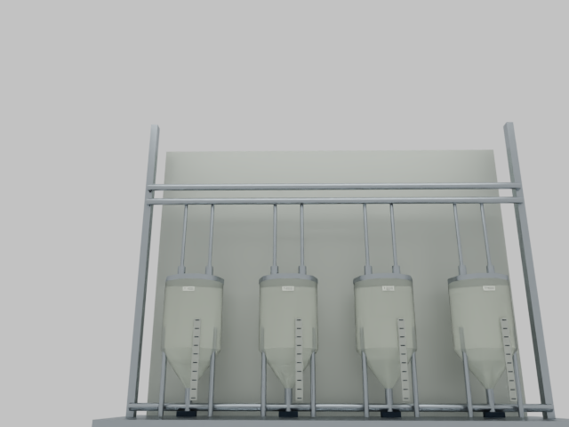
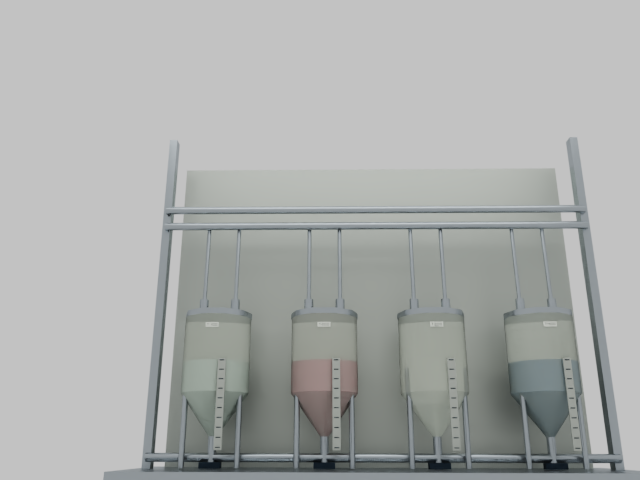
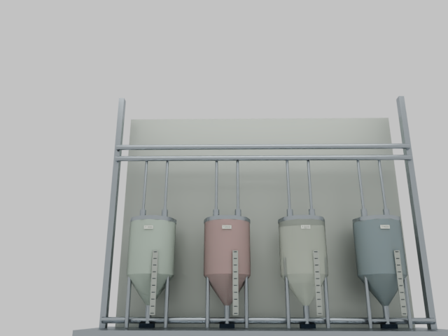
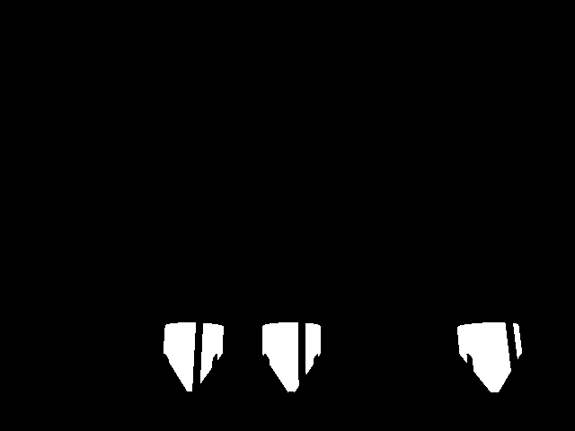
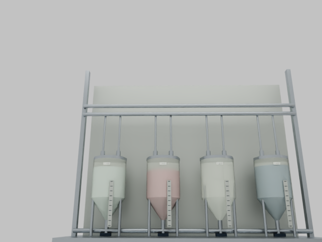

# Tank station validation evidence

Scope: generated tank assets and synthetic capture integrity. This evidence does not
measure real-world volume accuracy or train a detector. Self-review only.

## Provenance review correction

PR review found that the original capture checker hashed only the top-level USD file.
For composed scenes that did not protect referenced geometry, camera, material or
texture files. The current renderer records all source dependency hashes before capture
and verifies them again at completion; the checker requires and verifies that manifest.
Regression checks exercise unchanged composition files with changed referenced cameras,
meshes, materials and textures, plus missing dependencies and absent manifests.

The 12 native captures below are historical schema-version-1 evidence from before this
fix. Their image/label checks passed then, but they do **not** establish complete
dependency provenance and the current checker intentionally rejects their old summaries.
The render path and assets are unchanged. A fresh schema-version-2 native capture remains
unverified: both SSH connection attempts to Spark timed out during this review.
Current local verification: 94 tests pass, including 33 tank tests. The counts below
describe the original capture revision.

CPU verification on macOS with Python 3.11 and usd-core 26.11: 88 tests passed, including
27 tank tests. Synthetic absorbance smoke passed. Agent-doc checks passed (11 skills, 34 document targets).
The existing diagnostic fit still reports negative absorbance and is not a physical gate.

The checked-in static USDA regenerates byte-for-byte. It has 230 prims, one layer and
no external assets. The composed full line has 8585 prims, eight layers, two referenced
textures and zero missing dependencies. All 16 original twin files retain their saved
SHA-256 hashes. Full-line composition was checked through USD and rendered natively at frames 1, 343
and 686. All three image/label pairs passed the same capture audit on Spark.

Native runtime: existing Spark GB10, driver 580.178.04, Isaac Sim 6.0.1 / USD 26.8,
640×480 PathTracing with 32 subframes. The private runtime path was approved by the user.
Runtime startup is intermittent: one attempt timed out before extension startup and
another crashed during application startup before the scene opened. Those attempts
are failures, not successful captures.

Earlier captures exposed a real decoder bug: Isaac returned lowercase classes such as
`liquid_t100`, while the lookup expected uppercase tank IDs. The decoder now normalizes
case, with a regression test. The corrected nine-state sweep completed in 40.07 seconds including startup. Every
frame captured on its first RGB attempt, and the separate capture audit passed.

## Native sweep results

The first five states fill each active tank to 0%, 2%, 17%, 50% and 100% of its assumed
2976.1354 mL capacity. Later states independently empty tanks, then return all to empty.

| Frame | T100 pixels | T200 pixels | T300 pixels | T400 pixels |
|---|---:|---:|---:|---:|
| 1: empty | 0 | 0 | 0 | 0 |
| 2: 2% | 259 | 325 | 0 | 417 |
| 3: 17% | 1306 | 1386 | 0 | 1615 |
| 4: 50% | 3109 | 3176 | 0 | 3537 |
| 5: 100% | 5961 | 6005 | 0 | 6561 |
| 6: independent | 4884 | 0 | 0 | 1156 |
| 7: independent | 0 | 4944 | 0 | 1156 |
| 8: independent | 890 | 979 | 0 | 0 |
| 9: empty again | 0 | 0 | 0 | 0 |

All RGB/mask sizes, volume labels, IDs, pixel counts and bounding boxes passed the audit.
Masks grew strictly over the five fill states. T300 stayed absent in all nine frames.
All eight distinct authored states had distinct RGB files. Empty, half-full and full
RGB plus half-full liquid support were inspected visually. This is a small boundary
canary, not an exhaustive renderer test or evidence of model accuracy.

[Capture summary and source hashes](assets/tank-station/capture-summary.json) record the
exact source USDC hash, renderer script hash and per-frame RGB hashes. The full raw mask
arrays and nine frame pairs remain in ignored run outputs. Reproduce them with the sweep
commands in [tank station](tank-station.md); selected PNG evidence is committed below.
Path tracing is stochastic, so pixel-identical rerenders are not promised.

Empty:

Half-full active tanks, with inactive T300:

Full active tanks:

Half-full geometric liquid support (shells hidden for labels; other occluders retained):

## Conclusion and limits

The asset and renderer can produce internally checked synthetic tank-level image/label
pairs on the existing runtime. The committed static asset and generator are ready for
controlled synthetic training experiments. No model was trained here and no claim of
real-world transfer is established. A production estimator still needs task-specific
variation, sequence-level split manifests, independent labels and acceptance targets.
The nine canary frames must not be advertised as a training dataset.

## Existing full-line integration

The new composition layer references the installed organizer twin and the generated tank
station. Native captures at frames 1, 343 and 686 passed the same audit. Liquid support
pixel counts were 15371, 11122 and 7088 respectively; T300 remained absent. The capture
completed in 31.07 seconds. This proves the layers load and render together;
it does not calibrate the placement or synchronize drainage with the prerecorded fill.

[Composed capture summary](assets/tank-station/composed-summary.json) records stage and
station hashes, the composed camera path and per-frame volume/label evidence.

